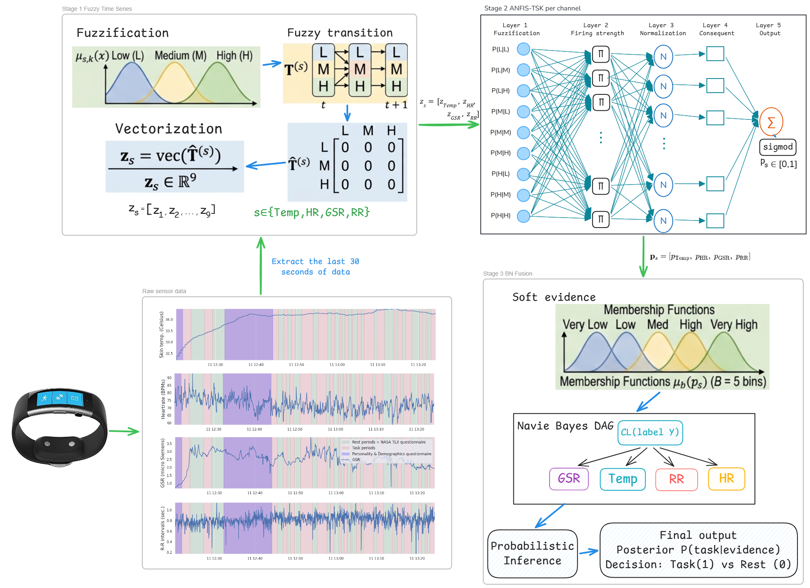
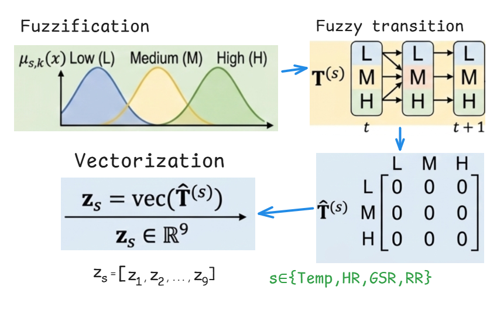
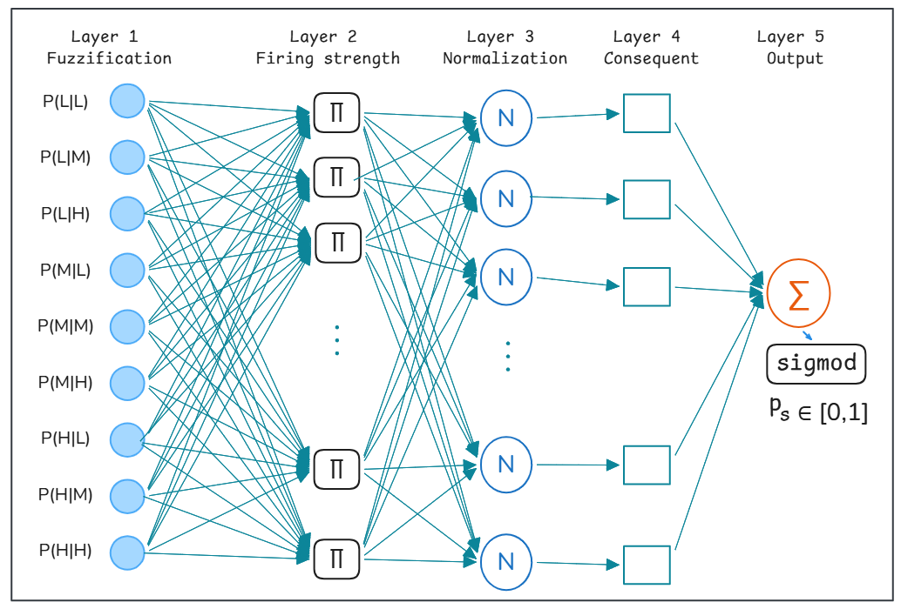
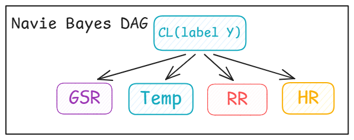

# Fuzzy Bayesian Network for Cognitive Load Classification

This project implements an interpretable cognitive load classification pipeline using physiological signals and a hybrid **Fuzzy Time Series → ANFIS → Bayesian Network** architecture.

The model is designed for research-oriented cognitive load estimation, with emphasis on:

- interpretability
- fuzzy linguistic representation
- temporal fuzzy transition modeling
- ANFIS-based per-signal inference
- Bayesian Network-based evidence fusion
- subject-independent evaluation

---

## 1. Introduction

Cognitive load estimation plays an important role in human–computer interaction, education, adaptive learning systems, and wearable sensing applications.

This project proposes an interpretable **Fuzzy Bayesian Network (FBN)** framework for cognitive load classification from physiological signals.

The physiological signals used in this project are:

- **HR**: Heart Rate
- **RR**: Respiration Rate
- **GSR**: Galvanic Skin Response
- **Temp**: Skin Temperature

The current implementation focuses on binary classification:

```text
rest → 0
task → 1
```

The final output of the model is:

```text
P(task | physiological evidence)
```

---

## 2. Dataset

This work uses the cognitive load dataset released for the UbiComp 2020 challenge by Gjoreski et al.

Dataset source:

```text
https://github.com/MartinGjoreski/martingjoreski.github.io/blob/master/files/CogDatasets.rar
```

The signals are segmented into fixed-length windows, for example 30-second windows.

The expected data folder is:

```text
last_30s_segments/
├─ labels.xlsx
├─ temp.xlsx
├─ hr.xlsx
├─ gsr.xlsx
└─ rr.xlsx
```

Each signal file contains time-series windows for one physiological signal.

After loading, the input tensor has the form:

```text
X shape = (N, 4, T)
```

where:

- `N` is the number of samples/windows
- `4` is the number of physiological signals
- `T` is the number of time points per window

The signal order used in the current implementation is:

```text
Temp, HR, GSR, RR
```

---

## 3. Project Structure

```text
project/
├─ main.py
├─ README.md
├─ results_main.csv
├─ last_30s_segments/
│  ├─ labels.xlsx
│  ├─ temp.xlsx
│  ├─ hr.xlsx
│  ├─ gsr.xlsx
│  └─ rr.xlsx
└─ src/
   └─ fbn_pipeline/
      ├─ __init__.py
      ├─ config.py
      ├─ data.py
      ├─ metrics.py
      ├─ pipeline.py
      ├─ reporting.py
      └─ models/
         ├─ __init__.py
         ├─ fts_encoder.py
         ├─ anfis_tsk.py
         └─ bn_fusion.py
```

---

## 4. Main Files

| File | Description |
|---|---|
| `main.py` | Main runner for loading data, running cross-validation, retraining, testing, and reporting |
| `config.py` | Defines experiment configuration and presets |
| `data.py` | Loads Excel data, stacks physiological signals, binarizes labels, and creates train/test splits |
| `fts_encoder.py` | Converts raw time-series windows into fuzzy transition features |
| `anfis_tsk.py` | Implements a 5-layer TSK/Sugeno ANFIS model |
| `bn_fusion.py` | Implements Bayesian Network fusion for ANFIS outputs |
| `pipeline.py` | Orchestrates FTS encoding, ANFIS training, BN fusion, cross-validation, and testing |
| `metrics.py` | Computes evaluation metrics and threshold tuning |
| `reporting.py` | Prints ANFIS rules, FTS transitions, BN CPTs, and saves experiment results |

---

## 5. Methodology

The proposed framework contains three main stages:


```text
Raw physiological windows
        ↓
Fuzzy Time Series Encoding
        ↓
Per-signal ANFIS Inference
        ↓
Bayesian Network Fusion
        ↓
Final cognitive load prediction
```

---

## 6. Stage 1: Fuzzy Time Series Encoding

For each physiological signal, the raw time-series window is transformed into fuzzy transition features.

Each signal value is fuzzified into linguistic states such as:

```text
Low, Medium, High
```

At each time step, the signal is represented by a fuzzy membership vector:

```text
μ_s(t) = [μ_L(x_s(t)), μ_M(x_s(t)), μ_H(x_s(t))]
```

The fuzzy transition matrix is computed as:

```text
T_ij = Σ_t μ_i(x_s(t)) · μ_j(x_s(t+1))
```

This matrix describes the degree to which the signal moves from fuzzy state `i` at time `t` to fuzzy state `j` at time `t+1`.

For 3 fuzzy states, each signal produces:

```text
3 × 3 = 9 fuzzy transition features
```

With 4 physiological signals, the full FTS feature vector contains:

```text
4 × 9 = 36 features
```

Supported membership functions:

- triangular
- gaussian
- trapezoid
- generalized bell

---

## 7. Stage 2: Per-Signal ANFIS Inference

After FTS encoding, each signal is modeled by a separate ANFIS classifier.


For each signal:

```text
FTS features of one signal → ANFIS → P(task | signal)
```

The four ANFIS models produce:

```text
[p_Temp, p_HR, p_GSR, p_RR]
```

Each ANFIS follows a 5-layer TSK/Sugeno architecture:

```text
Layer 1: Gaussian membership functions
Layer 2: Rule firing strengths
Layer 3: Normalized firing strengths
Layer 4: Linear TSK consequents
Layer 5: Weighted output aggregation
```

The raw ANFIS output is passed through a sigmoid function:

```text
p_s = sigmoid(y_s)
```

where `p_s` is interpreted as the probability of the task class for signal `s`.

---

## 8. Stage 3: Bayesian Network Fusion

The Bayesian Network combines the four ANFIS probabilities into one final posterior probability.

The current BN structure follows a Naive Bayes-style assumption:


The BN estimates:

```text
P(Task | E_Temp, E_HR, E_GSR, E_RR)
```

where each evidence node `E_s` is derived from the ANFIS output of signal `s`.

The posterior is computed as:

```text
P(Task = c | evidence) ∝ P(Task = c) · Π_s P(E_s | Task = c)
```

The implementation supports two evidence modes.

### Hard evidence

ANFIS probabilities are discretized into bins, for example:

```text
low, med, high
```

or with 5 bins:

```text
very_low, low, med, high, very_high
```

### Soft evidence

Instead of assigning one hard bin, the model uses Gaussian membership over bin centers:

```text
P(E_s | Task = c) = Σ_b μ_b(p_s) · P(bin_b | Task = c)
```

This helps reduce sensitivity when ANFIS probabilities are close to bin boundaries.

---

## 9. Evaluation Protocol

The project uses subject-independent evaluation.

The current split is based on subject IDs:

```text
Training subjects:
1mpau, 2nxs5, 5gpsc, 7swyk, 8a1ep, b7mrd, c24ur, dkhty,
e4gay, ef5rq, f3j25, hpbxa, ibvx8, iz2ps, rc1in, tn4vl,
wjxci, yljm5

Testing subjects:
3caqi, 6frz4, bd47a, f1gjp, iz3x1
```

The evaluation flow is:

1. Run `GroupKFold` cross-validation on the training subjects.
2. Generate out-of-fold posterior probabilities.
3. Select the best decision threshold from OOF predictions.
4. Retrain the full pipeline on all training subjects.
5. Evaluate on held-out test subjects.

Metrics include:

- Accuracy
- Balanced Accuracy
- Macro-F1
- F1-score
- AUC
- Confusion matrix
- Per-subject metrics

---

## 10. Experiment Presets

The project provides several predefined experiment presets in `config.py`.

| Preset | Description |
|---|---|
| `A1` | Triangular FTS, 3 fuzzy sets, default BN |
| `A2` | Gaussian FTS, row-normalized transition matrix, 5 BN bins |
| `A2_soft` | Same as A2, with soft Bayesian evidence |
| `A2_plus` | Adds robust FTS, scaling, reliability weighting, and calibration |
| `A3` | Trapezoidal FTS with more fuzzy sets and more ANFIS rules |
| `A4` | Generalized bell membership functions |
| `A5` | Gaussian FTS with 4 fuzzy sets |

The default preset in `main.py` is:

```python
PRESET_NAME = "A2_soft"
```

---

## 11. Installation

Create a virtual environment:

### Windows PowerShell

```bash
python -m venv .venv
.venv\Scripts\activate
```

### macOS / Linux

```bash
python3 -m venv .venv
source .venv/bin/activate
```

Install dependencies:

```bash
pip install numpy pandas scikit-learn openpyxl
```

If using notebooks:

```bash
pip install notebook ipykernel
```

---

## 12. How to Run

Run from the project root:

```bash
python main.py
```

Or run inside a notebook:

```python
%run main.py
```

---

## 13. Main Configuration

The main settings are located in `main.py`:

```python
MODE = "single"
PRESET_NAME = "A2_soft"
EXP_NAME = "main_run"
DATA_FOLDER = "last_30s_segments"
CSV_PATH = "results_main.csv"
SAVE_CSV = True
SHOW_PER_SUBJECT = True
DUMP_RULES = False
```

To override hyperparameters:

```python
OVERRIDES = {
    "n_epochs": 20,
    "n_rules": 6,
    "bn_soft": True,
}
```

Important configuration groups:

### FTS parameters

```python
n_sets
mf_type
mf_sigma_scale
gbell_b
fts_norm
robust_fts
```

### ANFIS parameters

```python
n_rules
sigma_scale
ridge_lambda
n_epochs
lr
```

### Bayesian Network parameters

```python
n_bins
alpha
bn_soft
bn_reliability
```

### Evaluation parameters

```python
k_folds
threshold_metric
threshold_grid
rank_metric
```

---

## 14. Output

After running `main.py`, the program prints:

- pipeline configuration
- cross-validation results
- best threshold
- held-out test results
- confusion matrix
- per-subject metrics

If CSV saving is enabled, the results are written to:

```text
results_main.csv
```

---

## 15. Explainability

The project provides several explanation mechanisms.

### FTS explanation

The fuzzy transition matrix can be interpreted as temporal fuzzy rules:

```text
IF state(t) is Low THEN state(t+1) is Medium
```

### ANFIS explanation

Each ANFIS model can output IF–THEN rules:

```text
IF P(M|L) is Gauss(c, σ)
AND P(H|M) is Gauss(c, σ)
THEN y = a1·P(M|L) + a2·P(H|M) + b
```

### BN explanation

The Bayesian Network provides conditional probability tables:

```text
P(E_s = bin | Task = rest)
P(E_s = bin | Task = task)
```

### Sample-level explanation

For a single test sample, the model can report:

- ANFIS probability of each signal
- BN evidence bin of each signal
- posterior probability of task
- posterior probability of rest
- log-likelihood contribution of each signal

---

## 16. Relation to Previous Work

This work extends a previous classical Bayesian Network approach where physiological features were modeled using crisp states.

Previous implementation:

```text
https://github.com/TyTy7023/cogLoad_experiment.git
```

Compared with the previous BN-based approach, this project introduces:

- fuzzy linguistic modeling of physiological signals
- fuzzy temporal transition features
- ANFIS-based nonlinear per-signal inference
- Bayesian Network fusion of fuzzy evidence
- more interpretable sample-level reasoning

---


## Reference

```bibtex
@article{gjoreski2020cognitive,
  title   = {Monitoring Cognitive Load with Wearable Sensors},
  author  = {Gjoreski, Martin and Gjoreski, Hristijan and Luštrek, Mitja and Gams, Matjaž},
  journal = {Proceedings of the ACM on Interactive, Mobile, Wearable and Ubiquitous Technologies},
  volume  = {4},
  number  = {1},
  year    = {2020}
}
```

---
