# Main Notebook Documentation

## Overview

This notebook implements an **end-to-end machine learning pipeline** for **binary classification of cognitive load** (Rest vs. Task) using **multi-signal time-series data**. The pipeline integrates three main stages:

1. **FTS Encoding** (Fuzzy Time Series) — converts raw time-series into fuzzy transition matrix features
2. **ANFIS Models** (Adaptive Network-based Fuzzy Inference System) — 4 independent TSK (Takagi-Sugeno-Kang) neural-fuzzy classifiers, one per physiological signal
3. **Bayesian Network Fusion** — combines ANFIS outputs via a Naive Bayes classifier with discretised evidence

The classification is **subject-independent**, validated using **GroupKFold cross-validation** and **explainability traces** to understand per-signal contributions.

---

## Notebook Objective

- **Primary Goal**: Classify rest/task cognitive load states from 4 physiological signals (Temperature, Heart Rate, GSR, Respiratory Rate)
- **Approach**: Fuzzy logic + ANFIS + Bayesian Network fusion
- **Validation**: Subject-independent GroupKFold (k=5)
- **Output**: OOF metrics, test predictions, explainability per-sample, hyperparameter grid search
- **Problem Type**: Binary classification with probability calibration and threshold tuning

---

## Project / Model Pipeline

```mermaid
graph LR
    subgraph Data["Data Loading"]
        A["Raw Time-Series<br/>(N, n_signals, T)<br/>4 signals × 30s windows"]
    end
    
    subgraph FTS["1. FTS Encoding"]
        B["FTSEncoder<br/>Quantile-based partitioning<br/>n_sets MF per signal"]
        C["Fuzzy Transition Matrix<br/>n_sets² features per signal<br/>Total: 4 signals × 9 features = 36"]
    end
    
    subgraph ANFIS["2. ANFIS TSK (×4)<br/>one per signal"]
        D["FTS Features<br/>9-dim per signal"]
        E["KMeans init centers<br/>Gaussian premise"]
        F["Hybrid Learning<br/>WLS + Gradient Descent"]
        G["Output: P(task)<br/>per signal"]
    end
    
    subgraph BN["3. BN Fusion<br/>Naive Bayes"]
        H["Discretise ANFIS probs<br/>Quantile binning<br/>n_bins = 3"]
        I["Learn CPTs<br/>P(evidence|class)"]
        J["Inference<br/>P(task | all evidence)"]
    end
    
    subgraph Eval["Evaluation"]
        K["OOF Metrics<br/>default + tuned threshold"]
        L["Test Metrics<br/>on held-out set"]
        M["Explainability<br/>per-sample trace"]
    end
    
    A --> B --> C
    C --> D --> E --> F --> G
    G --> H --> I --> J
    J --> K --> L
    J --> M
```



**Pipeline stages:**
1. Load data + GroupKFold split
2. For each fold: FTS encode → fit 4 ANFIS → train BN on fold
3. Predict validation fold, collect OOF probabilities
4. Tune threshold on OOF (maximize F1)
5. Retrain full pipeline on entire training set
6. Evaluate on held-out test + explain a sample

---

## Data Input

| Aspect | Details |
|--------|---------|
| **File path** | `last_30s_segments/` (loaded by `load-data.py`) |
| **Shape** | `(N, 4, T)` — N windows, 4 signals, T time points (30s = 3000 samples @100Hz) |
| **Signals** | `["Temp", "HR", "GSR", "RR"]` — Physiological time-series |
| **Labels** | Binary: 0=Rest, 1=Task |
| **User IDs** | Subject identifiers for GroupKFold split |
| **Train split** | Used for fold splits + OOF collection |
| **Test split** | Held-out; evaluated after full retraining |
| **Preprocessing** | NaN imputation (per-signal median) in FTS encoder |

---

## Key Configurations

### Hyperparameters Table

| Parameter | Default | Type | Purpose |
|-----------|---------|------|---------|
| `N_SETS` | 3 | int | Fuzzy sets per signal (Low/Med/High) |
| `MF_TYPE` | "triangular" | str | Membership function type (triangular\|gaussian\|trapezoid\|gbell) |
| `MF_SIGMA_SCALE` | 0.5 | float | Gaussian σ scaling factor for MF width |
| `GBELL_B` | 2.0 | float | Generalized bell shape exponent |
| `N_RULES` | 8 | int | ANFIS KMeans clusters (fuzzy rules) |
| `SIGMA_SCALE` | 1.5 | float | ANFIS Gaussian premise width multiplier |
| `RIDGE_LAMBDA` | 0.1 | float | Ridge regularization in WLS consequent fit |
| `N_EPOCHS` | 15 | int | Hybrid-learning iterations (WLS + GD) |
| `LR` | 0.001 | float | Gradient descent learning rate for premise |
| `N_BINS` | 3 | int | BN evidence bins (quantile discretization) |
| `ALPHA` | 1.0 | float | Laplace smoothing in CPT estimation |
| `K_FOLDS` | 5 | int | GroupKFold train/val splits |
| `SAMPLE` | 0 | int | Test sample index for explainability trace |

### Normalization & Discretization

| Aspect | Value |
|--------|-------|
| **FTS normalization** | `"total_sum"` — all T_ij normalized by Σ_ij T_ij |
| **BN binning** | Quantile-based (e.g., [1/3, 2/3] for 3 bins: low/med/high) |
| **Threshold tuning** | Optimize F1 on OOF predictions, range [0.05, 0.95], 181 grid points |

---

## Step-by-Step Cell Breakdown

### Cell 1: Dependency Setup (Optional)
- **Purpose**: Install required packages (scikit-learn, pandas, numpy, openpyxl, matplotlib)
- **Input**: None (commented out; run once if needed)
- **Output**: Installed packages
- **Status**: Skipped if dependencies already installed

### Cell 2: Data Loading
- **Purpose**: Import the custom `load_data()` function and load train/test splits
- **Input**: 
  - Data path: `last_30s_segments/`
  - Loads via `load-data.py` using importlib (hyphenated filename)
- **Output**:
  - `X_train, y_train, user_train` — training set (shape: N_tr × 4 × T)
  - `X_test, y_test, user_test` — test set (shape: N_test × 4 × T)
  - `DATA_PATH` — string path constant
- **Dependencies**: None

### Cell 3: Imports & Configuration
- **Purpose**: Import module libraries, reload custom modules, define all hyperparameters in one place
- **Input**: `load-data.py`, `fts_encoder.py`, `anfis_tsk.py`, `bn_fusion.py`, `eval_utils.py`
- **Output**:
  - Global constants: `N_SETS`, `MF_TYPE`, etc.
  - `CONFIG` dict with all hyperparameters
  - Imported classes: `FTSEncoder`, `ANFIS_TSK`, `BNFusion`
  - Prints formatted config table
- **Dependencies**: Cell 2

### Cell 4: GroupKFold Cross-Validation
- **Purpose**: Split training data by subject, perform 5 folds of (FTS → ANFIS × 4 → BN)
- **Input**: `X_train`, `y_train`, `user_train`, hyperparameters
- **Process** (per fold):
  1. **FTS Encoding**: Fit `FTSEncoder` on train fold, transform both train and val
     - Output: `F_tr (N_tr, 36)`, `F_va (N_va, 36)` — 9 features per signal × 4 signals
  2. **ANFIS (4 models)**: One ANFIS per signal
     - Input: 9-dim FTS features for signal s
     - Output: `P(task)` probability (shape: N × 1)
     - Result: `ap_tr (N_tr, 4)`, `ap_va (N_va, 4)`
     - Training: KMeans init + hybrid learning (WLS + GD)
  3. **BN Fusion**: Discretize ANFIS outputs, estimate CPT, predict posterior
     - Input: `ap_tr, y_tr` (for CPT fit)
     - Output: Posterior `P(task | evidence)` for validation set
  4. **Store OOF probs**: Collect validation fold predictions in `oof_probs`
- **Output**:
  - `oof_probs (N_train,)` — out-of-fold probabilities (no NaN)
  - Fold-level accuracy/F1 printed
- **Dependencies**: Cell 3

### Cell 5: OOF Evaluation & Threshold Tuning
- **Purpose**: Evaluate OOF predictions with default (0.5) and tuned threshold
- **Input**: `oof_probs`, `y_train`
- **Process**:
  1. Compute metrics at threshold=0.5: accuracy, F1, confusion matrix, classification report
  2. Grid search thresholds [0.05, 0.95] to find best F1
  3. Re-compute metrics at best threshold
- **Output**:
  - `best_thr, best_f1` — optimal threshold and F1 score
  - Printed metrics for both thresholds
- **Dependencies**: Cell 4

### Cell 6: Full Training + Test Evaluation
- **Purpose**: Retrain entire pipeline on full training data, evaluate on held-out test
- **Input**: `X_train`, `y_train`, `X_test`, `y_test`, `best_thr` (from Cell 5)
- **Process**:
  1. **FTS**: Fit on full training data
     - Output: `F_train_full`, `F_test`
  2. **ANFIS × 4**: Train on full data
     - Stored in `anfis_models` list
     - Output: `ap_train_full`, `ap_test`
  3. **BN**: Fit CPT on full data
     - Output: BN object `bn_full`
  4. **Test predictions**: Discretize `ap_test`, predict posterior, apply best_thr
     - Output: `test_preds` (0/1 binary)
  5. **Print BN CPT tables**: Show learned conditional probability tables
- **Output**:
  - `test_posteriors (N_test,)` — posterior probabilities
  - `test_preds (N_test,)` — binary predictions
  - `bn_full` object — trained BN model
  - `anfis_models` list — trained ANFIS models
  - Printed test metrics (accuracy, F1, confusion matrix, classification report)
- **Dependencies**: Cells 3, 4, 5

### Cell 7: Explainability Trace (Sample #0)
- **Purpose**: Detailed walkthrough of inference for one test sample to understand decision process
- **Input**: 
  - `X_test[SAMPLE]` (one 30s time-series window)
  - `fts_full`, `anfis_models`, `bn_full`
  - `best_thr` for decision boundary
- **Process** (for sample #0):
  1. **Transition matrices**: Compute 3×3 fuzzy transition matrix per signal
     - Shows high-level membership transitions (Low→Med→High)
  2. **ANFIS outputs**: Print `P(task)` from each of 4 ANFIS models
  3. **BN evidence bins**: Discretised ANFIS outputs (e.g., "low", "med", "high")
  4. **BN posterior**: P(rest | evidence), P(task | evidence)
  5. **Signal contributions**: Log-likelihood ratio `LL(task) - LL(rest)` per signal
     - Positive ratio → signal favors task
     - Negative ratio → signal favors rest
  6. **CPT values**: Show learned conditional probs P(bin | class) for each signal
- **Output**:
  - Formatted explanation table with all inference steps
  - Interpretation guide
- **Dependencies**: Cells 4, 6

### Cell 8: Run Experiments (Single Mode)
- **Purpose**: Execute `run_experiments.py` CLI script for single preset configuration
- **Input**: Calls `%run run_experiments.py --mode single --exp A1`
- **Process**: Runs full pipeline with preset "A1" configuration
  - Preset A1: triangular MF, n_sets=3, n_rules=8, beta=15, etc.
- **Output**: Console log + experiment result saved to CSV
- **Dependencies**: All previous cells (modules reloaded)
- **Note**: Module cache cleared before running to ensure latest code

### Cell 9: Run Experiments (Grid Search)
- **Purpose**: Execute grid search over hyperparameter space filtered by accuracy metric
- **Input**: Calls `%run run_experiments.py --mode grid --primary_metric accuracy`
- **Process**: 
  - Search over n_sets, mf_type, n_rules, lr, n_bins, etc.
  - Evaluate each config via GroupKFold CV
  - Select best by OOF accuracy
  - Return top config details
- **Output**: Console log + all results appended to experiment CSV

### Cell 10-11: Additional Grid Searches
- **Purpose**: Further grid searches with different max_configs
- **Input**: Vary `--primary_metric accuracy` and `--max_configs 300`
- **Output**: Extended hyperparameter exploration results

### Cell 12: Empty (Final)
- **Purpose**: Placeholder / end of notebook
- **Input/Output**: None

---

## Functions and Classes

### From `fts_encoder.py`

**Class: `FTSEncoder`**
- **Constructor params**: `n_sets`, `mf_type` (triangular/gaussian/trapezoid/gbell), `mf_sigma_scale`, `gbell_b`, `norm_mode`
- **Methods**:
  - `fit(X)` — Learn MF parameters from training data
  - `fit_transform(X)` — Fit and transform in one call
  - `transform(X)` — Apply fitted MFs to new data (N, S, T) → (N, S×n_sets²)
  - `get_transition_matrix(sample, signal_idx)` — Get 3×3 transition matrix for one signal (for explainability)
- **Key Logic**: 
  - Triangular: quantile-based (backward compatible with [0, 1/6, 0.5, 5/6, 1])
  - Others: grid-based (even spacing)
  - Fuzzification: keep all membership degrees, compute ∑_t μ_i(x_t)·μ_j(x_{t+1})

### From `anfis_tsk.py`

**Class: `ANFIS_TSK`**
- **Constructor params**: `n_rules`, `sigma_scale`, `ridge_lambda`, `n_epochs`, `lr`, `random_state`
- **Methods**:
  - `fit(X, y)` — Train ANFIS on 9-dim FTS features
  - `predict_proba(X)` — Return P(task) ∈ [0, 1] via sigmoid
  - `predict(X, threshold)` — Binary {0, 1}
- **Architecture**: 5-layer TSK
  - Layer 1: Gaussian premise MF (KMeans centers + learnable σ)
  - Layer 2: Firing strength (product of memberships, log-space)
  - Layer 3: Normalized firing strength (softmax)
  - Layer 4: Linear consequent f_r(x) = a_r^T x + b_r
  - Layer 5: Output weighted sum + sigmoid
- **Training**: Hybrid learning
  - Forward: WLS to fit consequent (ridge regularization)
  - Backward: Gradient descent on premise parameters (centers, sigmas)

### From `bn_fusion.py`

**Class: `BNFusion`**
- **Constructor params**: `n_bins`, `alpha` (Laplace smoothing)
- **Methods**:
  - `fit(probs, y)` — Learn bin edges and CPTs from training fold
  - `predict_proba(probs)` — Return P(task | evidence)
  - `predict(probs, threshold)` — Binary {0, 1}
  - `get_evidence_bins(probs)` — Return discretized evidence matrix (diagnostic)
  - `get_cpt_table()` — Return CPTs as nested dict for pretty-printing
  - `explain_sample(probs)` — Return full explanation dict (evidence, posterior, log-likelihoods)
- **Constants**: 
  - `SIGNAL_NAMES = ["Temp", "HR", "GSR", "RR"]`
  - `BIN_NAMES = ["low", "med", "high"]` (for 3 bins)
- **Inference**: Naive Bayes with exact inference
  - P(Task=c | e) ∝ P(Task=c) · ∏_s P(E_s = e_s | Task=c)
  - Log-space for numerical stability

### From `eval_utils.py`

**Function: `print_metrics(y_true, y_pred, title)`**
- Prints accuracy, F1, confusion matrix, classification report

**Function: `find_best_threshold(y_true, y_prob, metric, low, high, n_grid)`**
- Grid search over thresholds [low, high]
- Return (best_thr, best_score)

**Function: `print_config(config_dict)`**
- Pretty-print configuration table

---

## Training / Validation Strategy

### Cross-Validation Approach
- **Method**: `GroupKFold(n_splits=5)` — subject-independent splits
  - Each fold contains data from mutually exclusive subjects
  - Prevents subject leakage (data from same person not in both train & val)
- **Folds**: 5 (K_FOLDS=5)

### Training Per Fold
1. **FTS Encoder**: Fit on training fold, transform both train & val
   - MF parameters learned from train only (no leakage)
2. **ANFIS Models**: Fit on training fold FTS features
   - KMeans initialization from train
   - Hybrid learning: WLS on train, GD on train
3. **BN Fusion**: Fit CPT on training fold ANFIS outputs
   - Bin edges learned from train only
   - CPT counts from train only

### OOF Validation
- Collect validation-fold predictions across all folds
- Threshold tuning on OOF: grid search [0.05, 0.95] for max F1
- Report OOF metrics at default (0.5) and tuned threshold

### Final Test Evaluation
- Retrain entire pipeline on **full training set**
- Evaluate on held-out test set using **best_thr** from OOF tuning
- Do **NOT** use test set to tune threshold (avoid overfitting to test)

---

## Evaluation Metrics

| Metric | Computation | Usage |
|--------|-------------|-------|
| **Accuracy** | (TP + TN) / (TP + TN + FP + FN) | Overall correctness |
| **F1-Score** | 2 · (Precision × Recall) / (Precision + Recall) | OOF threshold tuning (primary) |
| **Confusion Matrix** | `[TN, FP; FN, TP]` | Class-wise error analysis |
| **Classification Report** | Precision, Recall, F1 per class | Detailed per-class breakdown |

### Threshold Tuning
- **Strategy**: Grid search on OOF probabilities
- **Range**: [0.05, 0.95]
- **Grid points**: 181
- **Metric**: F1-score (other options: accuracy, balanced_accuracy)
- **Apply to**: All test predictions

---

## Output Files / Artifacts

| File | Purpose | Generated By |
|------|---------|--------------|
| `experiment_results.csv` | Grid search results (all configs + OOF/test metrics) | `run_experiments.py` |
| `best_config.json` | Best configuration from grid search | `run_experiments.py` |
| `test_report.txt` | Test metrics summary | Manual export (not auto) |
| `main.ipynb` | This notebook (checkpoint after execution) | Jupyter auto-save |

### Console Outputs (not saved)
- Fold-level metrics (accuracy, F1)
- OOF evaluation (default + tuned)
- BN CPT tables
- Explainability trace
- Grid search progress

---

## How to Run

### Prerequisites
```bash
pip install -r requirements.txt
# Typical: numpy, pandas, scikit-learn, openpyxl, matplotlib
```

### Run Full Pipeline (Notebook)
1. Open `main.ipynb` in Jupyter or VS Code
2. **Cell 2**: Ensure `DATA_PATH` points to correct data directory
3. **Cell 3**: Review hyperparameters, adjust if needed
4. Run **Cells 2–7** in order for main pipeline
   - Cell 4: Cross-validation (3–5 min for 5 folds)
   - Cell 5: Threshold tuning (fast)
   - Cell 6: Full retrain + test (1–2 min)
   - Cell 7: Explainability trace (seconds)
5. **Cells 8–11** (optional): Run experiment grids
   - Cell 8: Single preset (A1)
   - Cells 9–11: Grid searches (10–30+ min depending on config space)

### Run Experiments via CLI
```bash
# Single preset
python run_experiments.py --mode single --exp A1

# Custom single config
python run_experiments.py --mode single --n_sets 4 --mf_type gaussian --lr 0.003

# Grid search
python run_experiments.py --mode grid --primary_metric f1

# Grid search with max configs limit
python run_experiments.py --mode grid --primary_metric accuracy --max_configs 300
```

---

## Important Notes / Assumptions

1. **Subject-Independent Validation**
   - GroupKFold uses `user_train` to ensure different subjects in train/val
   - Critical for real-world cognitive load detection (per-user personalization not tested)

2. **No Test Leakage**
   - Test set is **never used** during hyperparameter tuning
   - Best threshold tuned only on OOF (training set)
   - Test metrics are for **final evaluation only**

3. **FTS Sparsity**
   - Transition matrices can have 20–50% zeros (signal not transitioning)
   - This is expected and handled gracefully

4. **ANFIS Rule Initialization**
   - KMeans with `random_state=42` for reproducibility
   - Rules capped at `min(n_rules, max(N_fold/3, 2))` to avoid singular fits on small folds

5. **BN Discretization**
   - Bin edges learned **during fold training**, not fixed globally
   - Each fold might have slightly different bin boundaries (expected; part of CV)

6. **Laplace Smoothing**
   - Prevents zero probabilities in CPTs
   - Default alpha=1.0; tune if needed for different data sizes

7. **Sigmoid Output**
   - ANFIS raw output transformed via `sigmoid(x) = 1 / (1 + exp(-x))`
   - Produces probability-like outputs for BN input

---

## Potential Issues / TODO

### Known Issues

1. **Missing Data**
   - If input contains NaN, FTS encoder imputes with per-signal median
   - Check for excessive NaN → may indicate data preprocessing problem

2. **Small Folds**
   - If fold size < 6, KMeans may return fewer rules than requested
   - Monitor console output for "actual_rules" vs "n_rules" mismatch

3. **Extreme Imbalance**
   - If class ratio << 1:9 or >> 9:1, OOF metrics may be skewed
   - Consider balanced_accuracy or class weights (not currently used)

4. **Slow Grid Search**
   - Full grid over all hyperparameters can take 30+ min
   - Use `--max_configs` to limit exploration

### TODO / Potential Enhancements

1. **Model Persistence**
   - Save trained `fts_full`, `anfis_models`, `bn_full` to disk (pickle/joblib)
   - Enable inference on new data without retraining

2. **Hyperparameter Logging**
   - Log best OOF params alongside test metrics
   - Create reproducible "best model" card

3. **Confidence Intervals**
   - Run multiple seeds, report mean ± std OOF/test metrics
   - Assess stability of threshold tuning

4. **Signal Contribution Analysis**
   - Quantify per-signal importance (e.g., ablation study)
   - Which signal matters most for cognitive load?

5. **Adaptive Thresholding**
   - Per-subject threshold tuning (if subject IDs available in test)
   - Cost-sensitive thresholds (false positives vs. false negatives)

6. **Pipeline Visualization**
   - Plot membership functions (FTS)
   - Visualize ANFIS rule firing patterns
   - BN DAG visualization

7. **Batch Prediction API**
   - Wrap trained pipeline into a reusable class for inference
   - Standardize API: `clf.fit()`, `clf.predict_proba()`, `clf.explain()`

---

## Configuration Presets (from run_experiments.py)

| Preset | n_sets | mf_type | n_rules | n_epochs | lr | n_bins | Notes |
|--------|--------|---------|---------|----------|----|----|-------|
| **A1** | 3 | triangular | 8 | 15 | 0.001 | 3 | Default (balanced) |
| **A2** | 4 | gaussian | 10 | 20 | 0.003 | 3 | More fuzzy sets, gaussian MF |
| **A3** | 5 | trapezoid | 12 | 50 | 0.001 | 5 | Fine-grained, more training |
| **A4** | 3 | gbell | 6 | 10 | 0.005 | 3 | Bell-shaped MF, fewer rules |
| **A5** | 4 | gaussian | 8 | 20 | 0.001 | 5 | Balanced, row-norm FTS |

---

## Project Structure

```
anfis-bn-code/
├── main.ipynb                    # Main notebook (this documentation)
├── fts_encoder.py               # FTS encoding module
├── anfis_tsk.py                 # ANFIS TSK classifier module
├── bn_fusion.py                 # Bayesian Network fusion module
├── eval_utils.py                # Evaluation utilities
├── run_experiments.py            # CLI for experiment grid search
├── load-data.py                 # Data loader (hyphenated filename)
├── requirements.txt             # Python dependencies
├── best_config.json             # Best config from grid search
├── experiment_results.csv       # Grid search results table
├── test_report.txt              # Test evaluation summary
└── documents/
    └── main-notebook-doc.md     # This file
```

---

## References & Key Concepts

- **Fuzzy Time Series (FTS)**: Transition matrix represents fuzzy state changes
- **ANFIS (Adaptive Network-based Fuzzy Inference)**: Neural-fuzzy hybrid combining fuzzy logic with neural network learning
- **TSK (Takagi-Sugeno-Kang)**: Fuzzy inference with linear consequent (vs. singleton Mamdani)
- **Bayesian Network**: Probabilistic graphical model for uncertainty reasoning; Naive Bayes assumes conditional independence
- **Hybrid Learning**: Two-phase ANFIS training (forward WLS + backward GD)
- **GroupKFold**: Cross-validation respecting group boundaries (e.g., subjects)

---

**Document Date**: March 1, 2026  
**Notebook Status**: Fully functional, multiple cells executed successfully  
**Last Update**: Auto-generated from notebook introspection
