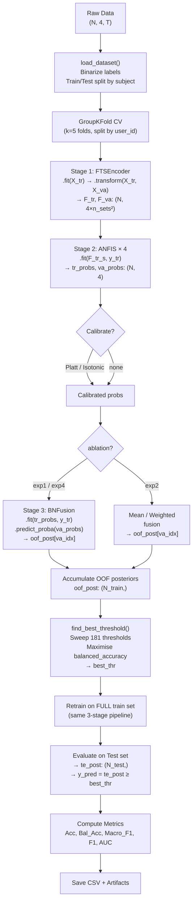

# Báo cáo Chi tiết: Quy trình Huấn luyện đến Kiểm thử — FBN Pipeline

> **Pipeline**: FTS (Fuzzy Time Series) → ANFIS (Adaptive Neuro-Fuzzy Inference System) → BN (Bayesian Network Fusion)  
> **Bài toán**: Phân loại nhận thức tải (Cognitive Load) nhị phân: `rest` (0) vs `task` (1)  
> **Dữ liệu**: 4 tín hiệu sinh lý — Nhiệt độ da (Temp), Nhịp tim (HR), Phản xạ da điện (GSR), Nhịp thở (RR)

---

## Mục lục

1. [Tổng quan kiến trúc](#1-tổng-quan-kiến-trúc)
2. [Dữ liệu đầu vào](#2-dữ-liệu-đầu-vào)
3. [Stage 1 — FTS Encoder](#3-stage-1--fts-encoder)
4. [Stage 2 — ANFIS TSK Classifier](#4-stage-2--anfis-tsk-classifier)
5. [Calibration (tuỳ chọn)](#5-calibration-tuỳ-chọn)
6. [Stage 3 — Bayesian Network Fusion](#6-stage-3--bayesian-network-fusion)
7. [Quy trình Cross-Validation (GroupKFold)](#7-quy-trình-cross-validation-groupkfold)
8. [Tìm ngưỡng phân loại tối ưu](#8-tìm-ngưỡng-phân-loại-tối-ưu)
9. [Retrain toàn bộ & Kiểm thử (Test)](#9-retrain-toàn-bộ--kiểm-thử-test)
10. [Luồng dữ liệu đầy đủ (exp1 - Full Pipeline)](#10-luồng-dữ-liệu-đầy-đủ-exp1---full-pipeline)
11. [Các biến thể Ablation](#11-các-biến-thể-ablation)
12. [Các Preset thực nghiệm](#12-các-preset-thực-nghiệm)
13. [Đánh giá & Kết quả](#13-đánh-giá--kết-quả)

---

## 1. Tổng quan kiến trúc

```
┌─────────────────────────────────────────────────────────────────────────┐
│                        FBN PIPELINE (exp1 - full)                       │
│                                                                         │
│  Raw signals (N, 4, T)                                                  │
│         │                                                               │
│         ▼                                                               │
│  ┌──────────────────┐                                                   │
│  │  Stage 1         │  FTSEncoder: fuzzify + build transition matrix    │
│  │  FTS Encoder     │  → (N, 4 × n_sets²) FTS features                 │
│  └────────┬─────────┘                                                   │
│           │                                                             │
│           ▼                                                             │
│  ┌──────────────────┐                                                   │
│  │  Stage 2         │  4 ANFIS models, 1 per signal                    │
│  │  ANFIS × 4       │  → (N, 4) per-signal P(task | signal_s)          │
│  └────────┬─────────┘                                                   │
│           │                     [optional] Calibration (Platt/Isotonic) │
│           ▼                                                             │
│  ┌──────────────────┐                                                   │
│  │  Stage 3         │  Naive Bayes BN: CPT + Laplace smoothing         │
│  │  BN Fusion       │  → (N,) posterior P(task | all signals)          │
│  └────────┬─────────┘                                                   │
│           │                                                             │
│           ▼                                                             │
│  Threshold → Binary prediction y_pred ∈ {0, 1}                         │
└─────────────────────────────────────────────────────────────────────────┘
```

**Nguồn code chính:**
| Bước | File |
|------|------|
| Cấu hình | `src/fbn_pipeline/config.py` |
| Nạp dữ liệu | `src/fbn_pipeline/data.py` |
| FTS Encoder | `src/fbn_pipeline/models/fts_encoder.py` |
| ANFIS | `src/fbn_pipeline/models/anfis_tsk.py` |
| BN Fusion | `src/fbn_pipeline/models/bn_fusion.py` |
| Điều phối pipeline | `src/fbn_pipeline/pipeline.py` |
| Metrics & ngưỡng | `src/fbn_pipeline/metrics.py` |
| Entry point | `main.py` |

---

## 2. Dữ liệu đầu vào

### 2.1 Cấu trúc file

```
last_30s_segments/
    labels.xlsx     ← user_id, level ("rest" | "task1" | "task2" | ...)
    temp.xlsx       ← Nhiệt độ da (skin temperature)
    hr.xlsx         ← Nhịp tim (heart rate)
    gsr.xlsx        ← Phản xạ da điện (galvanic skin response)
    rr.xlsx         ← Nhịp thở (respiration rate)
```

Mỗi hàng trong các file signal tương ứng với một **window 30 giây** của một subject.

### 2.2 Phân chia Train/Test (subject-independent)

| Tập | Số subject | Subject IDs |
|-----|-----------|-------------|
| **Train** | 18 | 1mpau, 2nxs5, 5gpsc, 7swyk, 8a1ep, b7mrd, c24ur, dkhty, e4gay, ef5rq, f3j25, hpbxa, ibvx8, iz2ps, rc1in, tn4vl, wjxci, yljm5 |
| **Test** | 5 | 3caqi, 6frz4, bd47a, f1gjp, iz3x1 |

> **Quan trọng**: Phân chia theo subject (subject-independent), không theo window ngẫu nhiên — đảm bảo không có data leakage giữa người dùng.

### 2.3 Binarize nhãn

```python
y = raw_labels                  # "rest", "task1", "task2", ...
y[y == "rest"] = -1             # rest → -1
y = y.astype(int) + 1          # rest → 0, task* → 1+
y[y > 0] = 1                   # tất cả task → 1
```

- `rest` → **0**
- `task` (bất kỳ mức nào) → **1**

### 2.4 Tensor dữ liệu

```
X_train : ndarray (N_train, 4, T)   — N windows, 4 signals, T timesteps
y_train : ndarray (N_train,)        — nhãn nhị phân {0, 1}
user_train: ndarray (N_train,)      — subject ID cho GroupKFold
X_test  : ndarray (N_test, 4, T)
y_test  : ndarray (N_test,)
```

---

## 3. Stage 1 — FTS Encoder

**File**: `src/fbn_pipeline/models/fts_encoder.py`  
**Mục đích**: Chuyển chuỗi thời gian thô → đặc trưng ma trận chuyển trạng thái mờ.

### 3.1 Ý tưởng FTS

Fuzzy Time Series không mã hoá giá trị cứng mà dùng **hàm liên thuộc (Membership Function)** để biểu diễn mỗi time step đồng thời thuộc nhiều trạng thái mờ (Low / Med / High khi n_sets=3). Sau đó xây dựng **ma trận chuyển trạng thái** mô tả xác suất chuyển từ trạng thái này sang trạng thái khác.

### 3.2 Bước Fit (chỉ trên train)

**Tham số học**: vị trí trung tâm và hình dạng của từng MF cho mỗi signal.

#### Triangular MF — Quantile-based partitioning

Với n_sets=3, dùng các phân vị [0%, 16.7%, 50%, 83.3%, 100%] để xác định 3 tam giác:
```
MF_Low  : (q0-margin, q1,  q2)
MF_Med  : (q1,        q2,  q3)
MF_High : (q2,        q3,  q4+margin)
```
Với n_sets tổng quát: tạo n+2 điểm quantile đều và xây n tam giác chồng lên nhau.

#### Gaussian / Trapezoid / Gbell MF — Grid-based partitioning

Chia đều khoảng [vmin, vmax] (có thể thêm 5% margin) thành n_sets tâm đều nhau:
```
centers = linspace(vmin_ext, vmax_ext, n_sets)
spacing = (vmax_ext - vmin_ext) / (n_sets - 1)
```
- **Gaussian**: `μ(x) = exp(−0.5·((x−c)/σ)²)` với `σ = spacing × mf_sigma_scale`
- **Trapezoid**: plateau hẹp trên [c−half_p, c+half_p], feet tại ±spacing
- **Gbell**: `μ(x) = 1 / (1 + |(x−c)/a|^{2b})` với `a = spacing × mf_sigma_scale`

Khi `robust=True`: dùng percentile 2%-98% clipping và quantile-based centers thay vì min/max.

### 3.3 Bước Transform

Với mỗi window `x[t]` (t = 0, ..., T−1):

**Bước 1 — Fuzzify holistic**: Tính tất cả n_sets membership degrees cho từng time step:
```
μ[n, t, k] = MF_k(x[n, t])   → shape (N, T, n_sets)
```
Chuẩn hóa: `μ[n, t, :] /= Σ_k μ[n, t, k]` (partition of unity)

**Bước 2 — Transition matrix**: Dùng outer product giữa hai bước thời gian liên tiếp:
```
T_ij = Σ_t  μ_i(x_t) · μ_j(x_{t+1})    (einsum "nti,ntj->nij")
```
→ shape `(N, n_sets, n_sets)` — ma trận n×n ghi lại co-activation của cặp trạng thái liên tiếp.

**Bước 3 — Normalize**:
- `total_sum`: `T /= Σ_{i,j} T_{ij}` — tổng toàn ma trận = 1
- `row`: `T[i] /= Σ_j T[i,j]` — mỗi hàng sum = 1 (như transition probability)

**Bước 4 — Flatten và concat**: Mỗi signal cho `n_sets²` features, 4 signal cho:
```
F = [T_signal0.flatten(), T_signal1.flatten(), T_signal2.flatten(), T_signal3.flatten()]
  → shape (N, 4 × n_sets²)    # VD: n_sets=3 → (N, 36)
```

### 3.4 NaN Imputation

Trước khi transform, các giá trị NaN được thay bằng **median** của từng signal, được tính từ tập train.

### 3.5 Optional StandardScaler

Nếu `cfg.scale_fts=True`, áp dụng `StandardScaler` (fit trên train, transform cả train/val) sau khi FTS encoding.

---

## 4. Stage 2 — ANFIS TSK Classifier

**File**: `src/fbn_pipeline/models/anfis_tsk.py`  
**Mục đích**: Học quy tắc mờ tổng quát (TSK/Sugeno style) để ánh xạ FTS features → P(task).

### 4.1 Kiến trúc 5 lớp

```
Input x ∈ ℝ^d (d = n_sets² = 9 với n_sets=3)
        │
        ▼ Layer 1 — Premise (Gaussian MF)
        μ_{r,j}(x_j) = exp(−(x_j − c_{r,j})² / (2σ_{r,j}²))
        shape: (N, R, d)
        │
        ▼ Layer 2 — Firing Strength (product rule, log-space)
        log w_r = Σ_j log μ_{r,j}
        shape: (N, R)
        │
        ▼ Layer 3 — Normalised Firing Strength (softmax)
        w̄_r = softmax(log w)_r = exp(log w_r) / Σ_k exp(log w_k)
        shape: (N, R)
        │
        ▼ Layer 4 — TSK Consequent (linear per rule)
        f_r(x) = a_r^T · x + b_r   (affine per rule)
        Φ[n, r*(d+1) : (r+1)*(d+1)] = w̄_r(n) · [x_n; 1]
        shape: (N, R×(d+1))
        │
        ▼ Layer 5 — Output
        ŷ = Σ_r w̄_r · f_r(x) = Φ · θ
        p = sigmoid(ŷ) = 1 / (1 + exp(−ŷ))
```

### 4.2 Khởi tạo tham số

**Premise (centers, sigmas)** — khởi tạo bằng **KMeans**:
```python
km = KMeans(n_clusters=min(n_rules, N//3), n_init=10)
km.fit(X)
centers = km.cluster_centers_          # (R, d)
sigmas  = std(X[cluster_r]) × sigma_scale  # per-cluster std
```
- `n_rules` được cap tại `max(N//3, 2)` để tránh lỗi KMeans trên fold nhỏ
- Floor: `sigmas = max(sigmas, global_std × 0.1, 1e-6)`

**Consequent (θ)** — khởi tạo sau forward pass đầu tiên bằng ridge regression.

### 4.3 Hybrid Learning

Mỗi epoch gồm 2 pha:

**Pha Forward — Weighted Least Squares (WLS) cho consequent θ:**
```
Φ = design matrix (N, R×(d+1))   — mỗi cột = w̄_r · [x; 1]
θ = (Φᵀ·Φ + λ·I)⁻¹ · Φᵀ · y     — ridge regression
```
Nếu ma trận singular, tự động tăng `lambda` qua [1e-3, 1e-2, 1e-1, 1.0], cuối cùng dùng pseudo-inverse.

**Pha Backward — Gradient Descent (GD) cho premise (centers, sigmas):**
```
Mất mát: L = (1/N) · Σ (ŷ − y)²
∂L/∂ŷ = (2/N)(ŷ − y)

Gradient qua softmax:
d_logw_s = w̄_s · (∂L/∂w̄_s − Σ_r ∂L/∂w̄_r · w̄_r)

Gradient cho centers và sigmas:
grad_c += Σ_n d_logw_{n,r} · (x_j − c_{r,j}) / σ_{r,j}²
grad_s += Σ_n d_logw_{n,r} · (x_j − c_{r,j})² / σ_{r,j}³
```
Gradient clipping: `||grad|| ≤ 10.0`  
Cập nhật: `centers -= lr × grad_c`, `sigmas -= lr × grad_s`  
Floor: `sigmas = max(sigmas, 1e-4)` (tránh collapse)

### 4.4 Output

```python
predict_proba(X) = sigmoid(Φ·θ) = 1 / (1 + exp(−clip(Φ·θ, −500, 500)))
```
→ P(task | signal_s) ∈ [0, 1]

### 4.5 Chạy song song 4 ANFIS

```
for s in [0, 1, 2, 3]:   # Temp, HR, GSR, RR
    F_s = F_train[:, s*d : (s+1)*d]   # FTS features của signal s
    anfis_s.fit(F_s, y_train)
    tr_probs[:, s] = anfis_s.predict_proba(F_tr_s)
    va_probs[:, s] = anfis_s.predict_proba(F_va_s)

→ tr_probs, va_probs : shape (N, 4)
```

---

## 5. Calibration (tuỳ chọn)

**File**: `src/fbn_pipeline/pipeline.py` — hàm `_calibrate_probs()`  
**Mục đích**: Cải thiện calibration của ANFIS outputs trước khi đưa vào BN.

Tham số `cfg.calibrate ∈ {"none", "platt", "isotonic"}`:

### Platt Scaling

```python
logit_p = log(p / (1 − p))                        # logit transformation
cal = LogisticRegression(C=1.0, max_iter=1000)
cal.fit(logit_tr.reshape(−1, 1), y_train)           # fit trên train fold
p_calibrated = cal.predict_proba(logit_va)[:, 1]    # apply trên val
```

### Isotonic Regression

```python
cal = IsotonicRegression(y_min=0, y_max=1, out_of_bounds="clip")
cal.fit(p_train, y_train)                            # fit trên train fold
p_calibrated = cal.predict(p_val)                    # apply trên val
```

> **Quan trọng**: calibrator được fit **chỉ trên train fold** và apply trên val/test — tránh data leakage.

---

## 6. Stage 3 — Bayesian Network Fusion

**File**: `src/fbn_pipeline/models/bn_fusion.py`  
**Mục đích**: Kết hợp 4 xác suất per-signal thành 1 posterior cuối cùng qua Naive Bayes BN.

### 6.1 Cấu trúc DAG

```
         Task (T)
        /  |   \  \
       /   |    \   \
    E_T  E_HR  E_GSR  E_RR
```
Naive Bayes assumption: các evidence node độc lập có điều kiện khi biết Task.

### 6.2 Fit (Discretisation + CPT Learning)

**Bước 1 — Quantile Binning** (fit chỉ trên train fold):
```python
qs = linspace(0, 1, n_bins+1)[1:-1]   # e.g. [1/3, 2/3] với n_bins=3
edges_s = quantile(p_train[:, s], qs)  # bin edges cho signal s
```
VD n_bins=5: tạo 4 edges → 5 bins [very_low, low, med, high, very_high]

**Bước 2 — Discretise**:
```python
bin_s = digitize(p[:, s], edges_s)      # 0-indexed bins
bin_s = clip(bin_s, 0, n_bins-1)
```

**Bước 3 — Prior P(Task=c)**:
```python
P(Task=c) = (count(y==c) + α) / (N + 2α)    # Laplace smoothing
```

**Bước 4 — CPT P(E_s = b | Task = c)**:
```python
cpt[c, b] = (count(y==c AND bin_s==b) + α) / sum_b(count + α)
```
Với `α = cfg.alpha` (Laplace smoothing, default 1.0).

### 6.3 Inference

**Hard Evidence** (mặc định):
```
log P(c | e) = log P(c) + Σ_s  w_s · log P(E_s=e_s | c)

→ softmax → P(Task=1 | evidence)
```

**Soft Evidence** (khi `cfg.bn_soft=True`):

Thay vì hard bin, dùng Gaussian kernel membership:
```
μ_b(p) = exp(−0.5 · ((p − mid_b) / σ)²)    normalized per sample

log P(c | e) = log P(c) + Σ_s  w_s · log (Σ_b  μ_b(p_s) · CPT[c, b])
```
Cho phép "mờ" ranh giới bin, tránh discontinuity.

### 6.4 Reliability Weighting

Khi `cfg.bn_reliability=True`, tính trọng số per-signal dựa trên AUC của ANFIS trên train fold:
```python
auc_s = roc_auc_score(y_train, tr_probs[:, s])
auc_s = max(auc_s, 1 − auc_s)             # đảm bảo ≥ 0.5
w_s = max(2·(auc_s − 0.5), 0.01)         # [0.01, 1.0]
```
Signal có AUC cao → trọng số cao hơn trong BN inference.

---

## 7. Quy trình Cross-Validation (GroupKFold)

**File**: `src/fbn_pipeline/pipeline.py` — hàm `run_cv()`  
**Mục đích**: Đánh giá OOF (out-of-fold) và chọn ngưỡng tối ưu mà **không dùng test set**.

### 7.1 Cơ chế GroupKFold

```
GroupKFold(k_folds=5) split theo user_id:
┌──────────────────────────────────────────────────────┐
│ Fold 1: [train: users A,B,...] [val: users X,Y]     │
│ Fold 2: [train: users A,B,...] [val: users M,N]     │
│ ...                                                  │
│ Fold 5: [train: users A,B,...] [val: users P,Q]     │
└──────────────────────────────────────────────────────┘
```
Đảm bảo: **mỗi subject chỉ xuất hiện ở 1 fold** → không có window của cùng 1 người ở cả train lẫn val.

### 7.2 Vòng lặp từng fold (exp1 - full pipeline)

```
for fold_i, (tr_idx, va_idx) in enumerate(gkf.split(X, y, users)):
    
    X_tr, X_va = X[tr_idx], X[va_idx]
    y_tr = y[tr_idx]

    # --- Stage 1 ---
    fts = FTSEncoder(n_sets, mf_type, ...).fit(X_tr)
    F_tr = fts.transform(X_tr)    # (N_tr, 4×n_sets²)
    F_va = fts.transform(X_va)    # (N_va, 4×n_sets²)
    
    # [optional] StandardScaler nếu scale_fts=True
    
    # --- Stage 2 ---
    for s in [0..3]:
        anfis_s.fit(F_tr[:, s×d:(s+1)×d], y_tr)
        tr_probs[:, s] = anfis_s.predict_proba(F_tr_s)
        va_probs[:, s] = anfis_s.predict_proba(F_va_s)
    
    # [optional] Calibrate (Platt / Isotonic)
    tr_probs, va_probs = _calibrate_probs(tr_probs, va_probs, y_tr, calibrate)

    # --- Stage 3 ---
    # [optional] signal weights nếu bn_reliability=True
    sw = _compute_signal_weights(y_tr, tr_probs)
    bn = BNFusion(n_bins, alpha, soft).fit(tr_probs, y_tr, signal_weights=sw)
    
    oof_post[va_idx] = bn.predict_proba(va_probs)

# Sau tất cả fold: oof_post là xác suất OOF đầy đủ trên toàn train set
```

### 7.3 Tích lũy OOF posteriors

Sau k folds, `oof_post` là array `(N_train,)` chứa xác suất posterior của **từng mẫu khi nó ở validation fold** — không có data leakage.

---

## 8. Tìm ngưỡng phân loại tối ưu

**File**: `src/fbn_pipeline/metrics.py` — hàm `find_best_threshold()`

```python
thresholds = linspace(0.05, 0.95, n_grid=181)   # 181 điểm thử

for t in thresholds:
    y_pred = (oof_post >= t).astype(int)
    score = balanced_accuracy(oof_y, y_pred)     # default metric
    
best_thr = argmax(scores)
```

Metric mặc định: `balanced_accuracy` (trung bình recall của 2 class).  
Các metric khác: `accuracy`, `f1`, `macro_f1`.

> **Lý do dùng balanced_accuracy**: Dữ liệu có thể mất cân bằng (nhiều `rest` hơn `task`), balanced_accuracy cân bằng recall của cả 2 class.

---

## 9. Retrain toàn bộ & Kiểm thử (Test)

**File**: `src/fbn_pipeline/pipeline.py` — hàm `retrain_and_test()`

### 9.1 Retrain trên full train set

```python
# Stage 1: Fit FTS trên toàn bộ X_train
fts = FTSEncoder(...).fit(X_train)
F_tr = fts.transform(X_train)   # (N_train, 36)
F_te = fts.transform(X_test)    # (N_test, 36)

# [optional] StandardScaler
scaler.fit(F_tr); F_tr = scaler.transform(F_tr); F_te = scaler.transform(F_te)

# Stage 2: Fit 4 ANFIS trên toàn bộ train
for s in [0..3]:
    anfis_s.fit(F_tr_s, y_train)
    tr_probs[:, s] = anfis_s.predict_proba(F_tr_s)
    te_probs[:, s] = anfis_s.predict_proba(F_te_s)

# [optional] Calibrate trên train → apply test
tr_probs, te_probs = _calibrate_probs(tr_probs, te_probs, y_train, calibrate)

# Stage 3: Fit BN trên toàn bộ train
bn = BNFusion(n_bins, alpha, soft).fit(tr_probs, y_train, signal_weights=sw)
te_post = bn.predict_proba(te_probs)    # (N_test,)
```

### 9.2 Phân loại final

```python
y_pred = (te_post >= best_thr).astype(int)    # dùng threshold từ OOF CV
```

Ngưỡng `best_thr` được tìm hoàn toàn trên OOF predictions của train set — **test set không tham gia chọn ngưỡng**.

### 9.3 Đánh giá trên test set

```python
acc      = accuracy_score(y_test, y_pred)
bal_acc  = balanced_accuracy_score(y_test, y_pred)
macro_f1 = f1_score(y_test, y_pred, average="macro")
f1       = f1_score(y_test, y_pred)
auc      = roc_auc_score(y_test, te_post)
```

---

## 10. Luồng dữ liệu đầy đủ (exp1 - Full Pipeline)

```
┌─────────────────────────────────────────────────────────────────────────────┐
│  TRAINING PHASE (GroupKFold × 5)                                            │
│                                                                             │
│  X_train (N=~1800, 4, T)  ──────────────────────────────────────────────┐  │
│                                                                          │  │
│  ┌─── Fold k ────────────────────────────────────────────────────────┐  │  │
│  │ X_tr (N_tr, 4, T)   X_va (N_va, 4, T)                            │  │  │
│  │      │                    │                                        │  │  │
│  │      ▼                    │                                        │  │  │
│  │  FTSEncoder.fit(X_tr)     │                                        │  │  │
│  │      │                    │                                        │  │  │
│  │   transform(X_tr)      transform(X_va)                            │  │  │
│  │      │                    │                                        │  │  │
│  │  F_tr (N_tr, 36)      F_va (N_va, 36)                             │  │  │
│  │      │                    │                                        │  │  │
│  │      ▼ [per signal s]     │                                        │  │  │
│  │  ANFIS_s.fit(F_tr_s)      │                                        │  │  │
│  │      │─predict_proba──→ tr_probs[:,s]                              │  │  │
│  │      │─predict_proba(F_va_s)─→ va_probs[:,s]                      │  │  │
│  │                                                                    │  │  │
│  │  [opt] Calibrate(tr_probs, va_probs, y_tr)                        │  │  │
│  │                                                                    │  │  │
│  │  BNFusion.fit(tr_probs, y_tr)                                      │  │  │
│  │      │─predict_proba(va_probs)─→ oof_post[va_idx]                 │  │  │
│  └───────────────────────────────────────────────────────────────────┘  │  │
│                                    ×5                                    │  │
│  oof_post (N_train,) ── find_best_threshold() ── best_thr ─────────────┘  │
│                                                                             │
├─────────────────────────────────────────────────────────────────────────────┤
│  TEST PHASE (Retrain on full train + Evaluate on test)                      │
│                                                                             │
│  X_train ─→ FTSEncoder.fit_transform ─→ F_tr (N_train, 36)                 │
│  X_test  ─→ FTSEncoder.transform     ─→ F_te (N_test, 36)                  │
│                                                                             │
│  F_tr,F_te ─→ ANFIS_s × 4 ─→ tr_probs (N_train,4), te_probs (N_test,4)   │
│                                                                             │
│  tr_probs,te_probs ─→ [opt Calibrate] ─→ calibrated probs                  │
│                                                                             │
│  tr_probs ─→ BNFusion.fit(y_train) ─→ BN model                             │
│  te_probs ─→ BNFusion.predict_proba ─→ te_post (N_test,)                   │
│                                                                             │
│  te_post ≥ best_thr ─→ y_pred (N_test,)                                    │
│                                                                             │
│  Metrics: Acc, Bal_Acc, Macro_F1, F1, AUC                                  │
└─────────────────────────────────────────────────────────────────────────────┘
```

---

## 11. Các biến thể Ablation

Tham số `cfg.ablation ∈ {"exp1", "exp2", "exp3", "exp4"}` cho phép bỏ từng stage:

| Variant | Stage 1 | Stage 2 | Stage 3 | Mô tả |
|---------|---------|---------|---------|-------|
| **exp1** | FTSEncoder | ANFIS × 4 | BNFusion | Full pipeline |
| **exp2** | FTSEncoder | ANFIS × 4 | Mean/Weighted fusion | Bỏ BN |
| **exp3** | Stat Features | ANFIS × 4 | BNFusion | Bỏ FTS, dùng stat features |
| **exp4** | FTSEncoder | FTS summary | BNFusion | Bỏ ANFIS |

### exp2 — Không có BN

Thay BN bằng fusion đơn giản của 4 ANFIS probabilities:
- `fusion_mode="mean"`: `posterior = mean(va_probs, axis=1)`
- `fusion_mode="weighted_mean"`: `posterior = Σ_s w_s · va_probs[:, s]` với `w_s` từ AUC trên train fold

### exp3 — Thay FTS bằng Statistical Features

8 đặc trưng thống kê cho mỗi signal (32 features tổng):
| STT | Feature | Công thức |
|-----|---------|-----------|
| 0 | mean | `mean(x)` |
| 1 | std | `std(x)` |
| 2 | min | `min(x)` |
| 3 | max | `max(x)` |
| 4 | range | `max(x) - min(x)` |
| 5 | slope | `OLS linear regression slope` |
| 6 | first_diff_mean | `mean(diff(x))` |
| 7 | first_diff_std | `std(diff(x))` |

### exp4 — Thay ANFIS bằng FTS Summary Score

Tóm tắt ma trận chuyển trạng thái FTS thành 1 điểm số liên tục per signal:

| Mode | Công thức | Ý nghĩa |
|------|-----------|---------|
| `diag` | `Σ_i T[i,i]` | Tổng xác suất tự chuyển (signal ổn định) |
| `high` | `Σ_i T[i,h] + Σ_j T[h,j] − T[h,h]` | Hoạt động tại trạng thái cao nhất |
| `diag_high` | `0.5·diag + 0.5·high_norm` | Cân bằng cả hai (mặc định) |
| `entropy` | `1 − H(T) / log(n_sets²)` | Mức độ tập trung của phân phối chuyển |

---

## 12. Các Preset thực nghiệm

| Preset | MF type | n_sets | n_rules | n_epochs | n_bins | Đặc điểm |
|--------|---------|--------|---------|----------|--------|-----------|
| **A1** | triangular | 3 | 8 | 15 | 3 | Baseline đơn giản |
| **A2** | gaussian | 3 | 6 | 50 | 5 | Gaussian MF, row norm |
| **A3** | trapezoid | 5 | 12 | 50 | 5 | 5 fuzzy sets, trapezoid |
| **A4** | gbell | 3 | 6 | 10 | 3 | Gbell MF, heavy smoothing |
| **A5** | gaussian | 4 | 8 | 20 | 5 | 4 fuzzy sets |
| **A2_soft** | gaussian | 3 | 6 | 50 | 5 | A2 + soft evidence BN |
| **A2_cal** | gaussian | 3 | 6 | 50 | 5 | A2 + isotonic calibration |
| **A2_plus** | gaussian | 3 | 6 | 50 | 5 | A2 + soft BN + reliability + robust FTS + isotonic cal |
| **A2_new** | gaussian | 3 | 6 | 20 | 3 | A2 với σ_scale=0.6 + soft BN |

---

## 13. Đánh giá & Kết quả

### 13.1 Metrics được báo cáo

| Metric | Ký hiệu | Công thức |
|--------|---------|-----------|
| Accuracy | acc | `TP+TN / (TP+TN+FP+FN)` |
| Balanced Accuracy | bal_acc | `0.5 × (TPR + TNR)` |
| Macro F1 | macro_f1 | `(F1_rest + F1_task) / 2` |
| F1 (task) | f1 | `2TP / (2TP + FP + FN)` |
| AUC | auc | Area under ROC curve |

### 13.2 Hai giai đoạn đánh giá

1. **OOF Cross-Validation**: đánh giá trên tập train với GroupKFold, dùng để chọn ngưỡng và so sánh config.
2. **Held-out Test**: đánh giá cuối cùng trên 5 test subjects, dùng ngưỡng từ bước OOF — **không được dùng để chọn threshold**.

### 13.3 Per-subject Analysis

Sau khi chạy test, có thể xem metrics riêng cho từng test subject qua `per_subject_metrics()` để phát hiện subject nào khó phân loại.

### 13.4 Artifact được lưu

| Artifact | Vị trí | Nội dung |
|----------|--------|---------|
| `anfis_rules.json` | `artifacts/{run_name}/` | Centers, sigmas, theta của ANFIS |
| `bn_details.json` | `artifacts/{run_name}/` | Prior, CPTs, bin edges của BN |
| `results_main.csv` | `results_main.csv` | Metrics của mỗi lần chạy |
| BN dashboard | `artifacts/{run_name}/` | Graph, inference trace, CPT heatmap |

---

## Sơ đồ luồng tóm tắt


